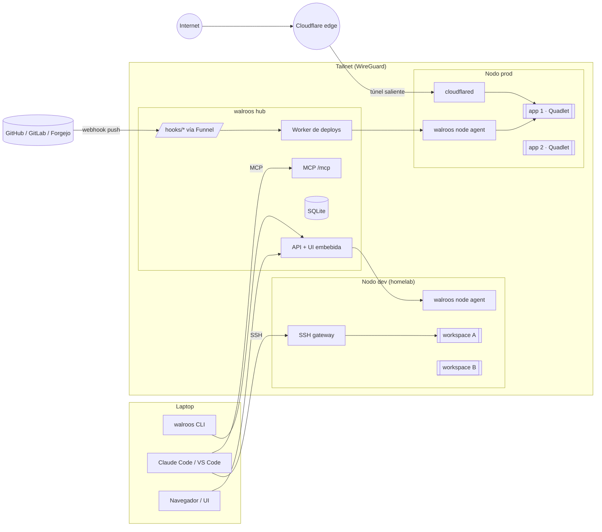

# Walroos — Arquitectura

Plataforma self-hosted, rootless y basada en Podman para dos cosas:

1. **Workspaces remotos**: entornos de desarrollo en contenedores, corriendo en nodos del homelab, accesibles por SSH desde cualquier máquina (laptop, Claude Code, VS Code).
2. **Deploy tipo Dokploy**: apps desde un repo Git a producción, con despliegue automático cuando se hace merge a la rama protegida.

Todo detrás de una API, una UI web y un servidor MCP.

### Alcance
- **Este repo es el producto self-hosted.** Lo instala una persona en su homelab o VPS. Es monousuario: un owner y, como mucho, algunos invitados de confianza.
- **`cloud.walroos.com` será otra aplicación encima.** La idea es aprovisionar **una instancia de walroos por tenant** y manejarla vía API. Así walroos nunca necesita multitenancy interna: el aislamiento lo da la instancia.
- **Consecuencia: API-first.** Todo lo que hace la UI lo hace la API pública con un token. Es lo que va a consumir la capa cloud.
- **Instalación trivial**: un binario más `curl -fsSL get.walroos.com | sh`, que escribe la unit systemd de usuario.

---

## 1. Topología



- **Un solo binario** `walroos`, con dos modos: `hub` (plano de control) y `node` (agente que ejecuta). El hub puede ser también nodo (`walroos hub --node`) para tener un setup de una sola máquina.
- **Red = Tailscale** embebido con `tsnet` en el hub (`walroos-hub`) y en cada nodo (`walroos-<nombre>`): no hace falta `tailscaled` en las máquinas y funciona detrás de otra VPN (NordVPN). Resuelve el NAT del homelab, da TLS entre componentes e identidad de usuario gratis. Compatible con Headscale.
- **Roles de nodo** como etiquetas: `dev`, `build`, `prod`. Un nodo puede tener varias.

### Comunicación hub ↔ nodo

| Dirección | Para qué | Cómo |
|---|---|---|
| nodo → hub | registro, heartbeat, telemetría | `POST /api/nodes/join`, `POST /api/nodes/{id}/heartbeat` (M0) |
| hub → nodo | crear/parar contenedores, build, quadlets, logs, terminal | API HTTP del agente sobre la tailnet |

El agente escucha solo en la tailnet (listeners de `tsnet`) y **solo** acepta peticiones cuya identidad (`LocalClient.WhoIs`) sea el hub, además de un token de nodo. No se expone el socket de Podman: el agente ofrece una API acotada y habla con Podman localmente por la CLI (`podman ...`).

Logs y eventos van por **SSE** (stdlib). La terminal web usa **WebSocket** (`coder/websocket`, ya en el árbol de dependencias).

---

## 2. Workspaces

### Ciclo de vida
1. Usuario: "crear workspace desde `github.com/me/proyecto`, rama `main`, nodo `homelab-1`".
2. Hub elige nodo (rol `dev`) y manda la orden al agente.
3. Agente: crea volúmenes, clona el repo, lee `.devcontainer/devcontainer.json`, construye o descarga la imagen y arranca el contenedor.
4. El workspace queda accesible por SSH: `ssh proyecto.homelab-1`.

### Imagen: `devcontainer.json`
Se usa el estándar que ya usan Codespaces, DevPod y Coder; no se inventa un formato propio.

- **v1, subconjunto**: `image`, `build.dockerfile`, `containerEnv`, `remoteUser`, `forwardPorts`, `postCreateCommand`, `mounts`.
- **Sin devcontainer** → imagen base de walroos (Debian, git, curl, mise para runtimes).
- **Si hacen falta `features`** → usar `@devcontainers/cli` con `--docker-path podman`, en vez de reimplementar el spec.

### Persistencia
Dos volúmenes por workspace, para que se pueda **reconstruir el contenedor sin perder trabajo**:
- `ws-<id>-src` → `/workspaces/<repo>`
- `ws-<id>-home` → `$HOME`. Aquí persisten `~/.claude`, `~/.ssh`, historial y caches.

### Acceso: SSH gateway en el agente
**No** se mete `sshd` dentro de cada imagen. El agente corre **un servidor SSH por nodo** (`golang.org/x/crypto/ssh`) en la tailnet:

- `user` en SSH = nombre del workspace. Una sesión se convierte en `podman exec -it` dentro del contenedor.
- Soporta `exec`, `pty`, `direct-tcpip` (port forwarding) y el subsistema `sftp` (`pkg/sftp`). Con eso funcionan VS Code Remote-SSH, la conexión SSH de la app de Claude y `scp`.
- Auth: claves públicas del usuario, guardadas en el hub y cacheadas por el agente.
- `walroos ssh-config` genera las entradas de `~/.ssh/config`:
  ```
  Host proyecto.walroos
    HostName homelab-1        # MagicDNS
    Port 2222
    User proyecto
  ```

**Caso de uso principal**: desde la laptop, Claude Code abre una sesión SSH a `proyecto.walroos` y trabaja ahí. bun, nvm, compiladores y el propio `claude` viven en el contenedor; la laptop no instala nada.

### Puertos de preview
- v1: port forwarding SSH (`ssh -L 3000:localhost:3000 proyecto.walroos`).
- v2: proxy del hub en `https://3000--proyecto.<hub>.ts.net`.

---

## 3. Apps y deploy

### Modelo
**App** = repo + rama + cómo se construye (`Dockerfile`; Railpack/Nixpacks en v2) + nodo destino + puerto interno + dominios + variables y secretos.

### Pipeline
```
trigger (webhook | botón UI | API | MCP)
  → Deployment{status: queued}
  → build:   git clone @sha  →  podman build -t walroos/<app>:<sha>
  → push:    podman push <build-node>:5000/<app>:<sha>      (solo si build ≠ destino)
  → release: pull en destino → Quadlet <app>-<sha> → systemctl --user daemon-reload && start
  → health:  GET http://<app>-<sha>:<port>/health; si falla → borrar el nuevo, el viejo sigue
  → route:   Ingress (CF Tunnel API | Caddy) → dominio → <app>-<sha>; parar el anterior
  → Deployment{status: succeeded | failed}
```

- **Cola**: tabla `deployments` y una goroutine worker en el hub. No hace falta un broker. El techo es un worker por hub; se paraleliza por nodo cuando duela.
- **Build en el nodo con rol `build` + registry en ese mismo nodo** (v1, porque el setup real separa build y prod).
  - El nodo de build corre un contenedor `registry` (distribution), escuchando solo en la tailnet (`<build-node>:5000`).
  - Flujo: `podman build` → `podman push <build-node>:5000/<app>:<sha>` → el agente de prod hace `podman pull`.
  - Si no hay ningún nodo `build`, se construye en el nodo destino y no se usa registry.
- **Runtime = Podman Quadlet** (`~/.config/containers/systemd/<app>.container`). systemd reinicia, arranca en boot y gestiona logs con journald. Es lo nativo de Podman, no un supervisor propio. Requiere `loginctl enable-linger`.
- **Rollback** = reescribir el Quadlet con la imagen `:<sha>` anterior. Se mantienen las N últimas imágenes.
- **Secretos** → `podman secret create` + `Secret=` en el Quadlet. En el hub van cifrados en SQLite (AES-GCM, con la clave maestra en un archivo `0600`).
- **Ingress**: dos proveedores detrás de una misma interfaz (`Ingress.Apply(app, domains, port)`). Es el único caso con dos implementaciones reales.
  - **Cloudflare Tunnel (default v1).** Cubre CGNAT, el caso de Venezuela.
    - Un contenedor `cloudflared` por nodo prod, con un túnel *remote-managed*.
    - **Red Podman `walroos`** (bridge, con DNS de aardvark) en cada nodo prod. `cloudflared` y todas las apps se unen a ella, y las apps **no publican puertos en el host**.
    - Walroos usa la API de Cloudflare (token con scope de zona) para crear el CNAME `app.walroos.com → <tunnel>.cfargotunnel.com` y la regla de ingress `hostname → http://<app>-<sha>:<port>`, que resuelve por nombre de contenedor.
    - El TLS lo pone el edge de Cloudflare. No hace falta Caddy ni puertos abiertos.
  - **Caddy (v2, para quien tenga IP pública real).** Configurado por su admin API, con TLS por ACME. Rootless: `net.ipv4.ip_unprivileged_port_start=80`.
  - **Tailscale Funnel no sirve para apps**: solo admite dominios `*.ts.net` (no `walroos.com`), unos pocos puertos y tiene límites de ancho de banda. Queda para webhooks.
  - **App privada** → solo en la tailnet, con certificado de `*.ts.net`.
- **Zero-downtime** (v1, sale casi gratis con la red `walroos`):
  1. Levantar `<app>-<sha>` junto al contenedor viejo.
  2. Healthcheck.
  3. Cambiar la regla de ingress al contenedor nuevo.
  4. Parar el anterior.
  - Si el healthcheck falla, se borra el nuevo y el viejo sigue sirviendo.
- **Compose** (v2): Quadlet `.kube`/`.pod`, o `podman compose`.

---

## 4. CI/CD — "deploy cuando el owner acepta el merge"

**Walroos no es un motor de CI.** La revisión y los tests los hace la forja; walroos solo despliega.

- **Aceptar el merge** = push a la rama protegida. La regla "nadie pushea a `main` sin review" se configura en la forja (branch protection). Walroos escucha el evento `push` en la rama configurada de la app.
- **Dos modos de trigger por app:**
  1. `on_push`: webhook firmado → deploy directo.
     - GitHub: `X-Hub-Signature-256`
     - GitLab: `X-Gitlab-Token`
     - Forgejo/Gitea: `X-Gitea-Signature`
  2. `on_ci`: el último job del workflow llama `POST /hooks/deploy/<app>` con un *deploy token* y el `sha`. Así se despliega solo si los tests pasaron.
     ```yaml
     - run: curl -fsS -X POST "$WALROOS_URL/hooks/deploy/myapp" -H "Authorization: Bearer ${{ secrets.WALROOS_TOKEN }}" -d '{"sha":"${{ github.sha }}"}'
     ```
- **Alcanzabilidad**: el hub vive en la tailnet y GitHub no la ve. Hay un listener aparte que sirve **solo** el router `/hooks/*`. La UI, la API y MCP nunca se exponen a Internet. El listener se publica de una de dos formas:
  - **Tailscale Funnel** (`tsnet.ListenFunnel`): default, cero configuración.
  - **Cloudflare Tunnel**: `hooks.walroos.com`, si ya está configurado para las apps.
  - Un Forgejo dentro de la tailnet llama directo.
- **Previews por PR** (v2): evento `pull_request` → deploy efímero en `pr-12--app.<dominio>`, que se destruye al cerrar el PR.

---

## 5. Auth

- **Usuarios = identidades de Tailscale.** El hub hace `WhoIs` de cada petición y la compara contra una allowlist de logins en la DB. v1 no tiene passwords ni pantalla de login.
- **API tokens** (hash en la DB, con scopes `read`, `workspaces`, `deploy`) para CLI, MCP y CI.
- **Deploy tokens** por app, con un solo scope, para `/hooks/deploy`.
- Los roles `owner` y `member` bastan para empezar. Más adelante, OIDC si alguien entra sin Tailscale.

---

## 6. MCP

El hub sirve MCP (streamable HTTP) en `/mcp`, autenticado con API token. Con `modelcontextprotocol/go-sdk` es una capa fina sobre los mismos servicios que usa la API.

Herramientas iniciales:
- `list_nodes`
- `list_workspaces`, `create_workspace`, `start_workspace`, `stop_workspace`, `workspace_ssh_info`
- `list_apps`, `deploy_app`, `get_deployment`, `get_deployment_logs`, `rollback_app`

Con esto, Claude Code en la laptop puede decir "crea un workspace para este repo", conectarse por SSH, trabajar, y después "despliega `main` a prod y muéstrame los logs".

---

## 7. Hub por dentro

```
cmd/walroos/          cobra: hub, node, ssh-config, ws, deploy
internal/
  fleet/              nodos, heartbeat, telemetría          (existe)
  agent/              API del nodo + SSH gateway + quadlets  (nuevo)
  workspace/          servicio + store + devcontainer parse  (nuevo)
  app/                apps, env, dominios                    (nuevo)
  deploy/             cola, worker, pipeline, rollback       (nuevo)
  forge/              webhooks + verificación de firma por proveedor (nuevo)
  auth/               WhoIs + allowlist (M0), tokens (nuevo)
  mcp/                herramientas MCP                       (nuevo)
  web/                embed.FS de la SPA                     (M0)
shared/whttp/         router + JSON                          (existe)
config/               sqlite + migrations/*.sql embebidas, tabla schema_version (M0)
```

- **Patrón por dominio**: `models.go`, `service.go`, `sqlite-store.go` y `handlers.go`, igual que `fleet` (`store.go` en vez de `sqlite-store.go`). Las interfaces solo existen donde hay dos implementaciones o tests que las necesitan.
- **SQLite** en modo WAL, con conexiones de escritura y lectura separadas, como ya está hecho.
- **Migraciones**: archivos `.sql` embebidos y aplicados en orden; reemplazan el `CREATE TABLE IF NOT EXISTS` de cada store.

### Esquema (v1)
```
users(id, ts_login, role, created_at)
ssh_keys(id, user_id, name, public_key)
api_tokens(id, user_id, name, hash, scopes, last_used_at)
nodes(id, name, ts_hostname, roles, token_hash, last_seen, telemetry_json)
git_providers(id, kind[github|gitlab|forgejo], base_url, token_enc, webhook_secret_enc)
workspaces(id, name, owner_id, node_id, repo_url, branch, devcontainer_path, image, state, created_at)
apps(id, name, node_id, provider_id, repo_url, branch, dockerfile, port, trigger[on_push|on_ci|manual], deploy_token_hash)
app_env(app_id, key, value_enc, secret bool)
app_domains(app_id, domain, public bool)
deployments(id, app_id, sha, trigger, status, image, started_at, finished_at, log_path)
```

---

## 8. UI

SPA estática embebida en el binario (`web/` se compila a `internal/web/ui/dist`, `//go:embed`). Habla solo con la API pública; no tiene un backend propio.

Pantallas:
- **Flota**: nodos, roles, CPU/RAM y "añadir nodo" (genera el comando `walroos node join ...`).
- **Workspaces**: lista, crear desde repo, estado, info de conexión (SSH / VS Code / Claude Code) y terminal web (xterm.js).
- **Apps**: config, variables, dominios, historial de deployments con logs en vivo y rollback.
- **Integraciones**: proveedores Git, webhooks y deploy tokens.
- **Ajustes**: usuarios, claves SSH y API tokens.

El diseño visual se hace con Open Design a partir de estas pantallas.

---

## 9. Roadmap

| Hito | Entrega | Prueba de "hecho" |
|---|---|---|
| **M0 Base** ✅ | join por token de un solo uso, heartbeat con telemetría, migraciones, auth con Tailscale (WhoIs + allowlist), UI React embebida con la página de nodos | la UI lista nodos con telemetría en vivo |
| **M1 Workspaces** ✅ | crear desde repo + subconjunto de devcontainer, volúmenes, SSH gateway, `ssh-config` | desde la laptop, `ssh proyecto.walroos` y `claude` corre dentro sin nada instalado localmente |
| **M2 MCP** | `/mcp` con herramientas de nodos y workspaces | Claude Code crea un workspace y se conecta a él |
| **M3 Deploy manual** | apps, build + registry en el nodo de build, Quadlet, red `walroos`, ingress con Cloudflare Tunnel, zero-downtime, logs, rollback | botón "Deploy" → `app.walroos.com` responde con TLS desde detrás del CGNAT |
| **M4 CI/CD** | proveedores Git, webhooks vía Funnel, `on_push` / `on_ci`, deploy tokens | merge de PR en GitHub → app actualizada sin tocar nada |
| **M5** | previews por PR, compose, features de devcontainer, Caddy para nodos con IP pública, notificaciones | — |

---

## 10. Decisiones de M0

- **El agente solo hace push en M0.** El nodo manda un heartbeat cada 15s y no expone ninguna API todavía. La API hub → nodo (con verificación WhoIs) llega en M1, que es cuando hay órdenes que mandar (crear contenedores).
- **Podman se usa por CLI**, no con las bindings de Go. Las bindings de `podman/v4` no compilan fuera de Linux y arrastran muchas dependencias. Para versión y número de contenedores basta con ejecutar el comando. En M1 se decide si se usa la API REST del socket.
- **La UI reutiliza el CSS del prototipo** (`web/src/styles.css`, copiado tal cual de `index.html`) en vez de Tailwind. Así se mantiene el diseño 1:1 sin traducirlo.
- **Tokens**: `wlr_join_*` (1h, un solo uso) y `wlr_node_*`. En la base de datos solo se guarda el sha256.
- **`--dev`**: el hub escucha en `127.0.0.1:8080`, sin Tailscale y sin auth (usuario `dev@localhost`). Sirve para desarrollar la UI con `bun run dev`.

## 11. Decisiones tomadas

1. **Usuarios**: monousuario en v1. El multitenant va en `cloud.walroos.com` como capa aparte, con una instancia por tenant (ver Alcance).
2. **Ingress**: Cloudflare Tunnel por defecto, por el CGNAT. Caddy queda para v2. Funnel solo para webhooks.
3. **UI**: Vite + React + TS con el CSS del prototipo (sin Tailwind), embebida con `embed.FS`. Acento magenta; logo en `web/public/`.
4. **Red**: Tailscale (o Headscale) es obligatorio en v1.
