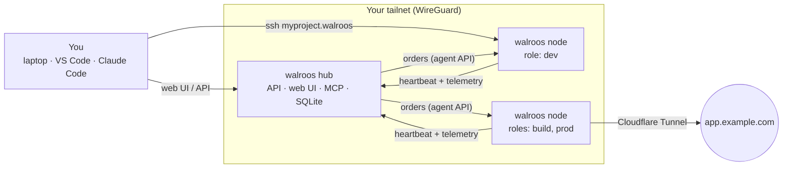

<div align="center">


# walroos

**Self-hosted dev workspaces and deploys on rootless Podman, over your Tailscale network.**

A lightweight devops platform for indie developers: run your dev environments and your apps on your own homelab or VPS, reach them from anywhere, and never open a port.

[](LICENSE)
[](go.mod)


</div>

> [!WARNING]
> walroos is in early development. The fleet (hub + nodes) works; workspaces are being built right now. Expect breaking changes and don't run it anywhere important yet.

## What it does

walroos is one Go binary with an embedded web UI. It does two things:

1. **Remote dev workspaces** (like Coder or DevPod). Spin up a container from a Git repo and its `devcontainer.json` on one of your machines. Connect over SSH from your laptop, VS Code or Claude Code: `ssh myproject.walroos`, and `bun`, compilers and `claude` all live in the container, not on your laptop.
2. **Deploys** (like Dokploy or a self-hosted Vercel). Build a repo (its `Dockerfile`, or a static site with Node or Bun, like Netlify), run it as a Podman Quadlet, and put it behind a domain with TLS. It deploys on merge to your protected branch, or when your CI says the tests passed.

Everything sits behind an API, a web UI and an MCP server, so an agent can do anything you can.

### Why

- **Rootless Podman.** No Docker daemon, no root. systemd runs your apps.
- **No open ports.** Machines talk over [Tailscale](https://tailscale.com) (or Headscale). Apps reach the internet through Cloudflare Tunnel, so it works behind CGNAT.
- **Your identity is your tailnet login.** No passwords and no login page: the hub asks Tailscale who is calling and checks an allowlist.
- **Standards, not new formats.** Workspaces use `devcontainer.json`, the same format as Codespaces, DevPod and Coder. Apps use a `Dockerfile`, or none for a static site.
- **Small.** One binary and SQLite, with no broker, no Kubernetes and no agent sidecars.

## How it works



- **Hub** (`walroos hub`): the control plane. It joins the tailnet by itself through an embedded Tailscale node (`tsnet`) and serves the API, the UI and, later, MCP.
- **Nodes** (`walroos node`): an agent on each machine. It joins with a one-time token, sends a heartbeat with telemetry every 15s, and runs Podman through its CLI.
  - Each node has roles: `dev` runs workspaces, `build` builds images, `prod` runs apps.
  - The agent API only accepts calls from the hub: the caller's tailnet identity must be the hub's, and it must carry the node's token hash.
- **Workspaces** are a container plus two volumes, one for the repo and one for `$HOME`, so `~/.claude`, shell history and caches survive a rebuild.
  - The container runs as the devcontainer's `remoteUser`, mapped to your host user, so files are yours on both sides.

The full design is in [ARCHITECTURE.md](ARCHITECTURE.md) (in Spanish).

## Requirements

- **Go ≥ 1.27.4** and **[bun](https://bun.sh)** to build.
- **Tailscale** (or Headscale) on every machine; the hub brings its own.
- **Podman** (rootless) and **git** on Linux nodes.

## Install

On each machine (the hub, every node, and your laptop for `walroos ssh-config`):

```bash
curl -fsSL https://raw.githubusercontent.com/jefjesuswt/walroos/main/install.sh | sh
```

It downloads the binary for your system from the [latest release](https://github.com/jefjesuswt/walroos/releases/latest), checks its SHA-256 and puts it in `~/.local/bin` (`WALROOS_INSTALL_DIR` for another place, `WALROOS_VERSION=v0.2.0` for another release). Linux binaries (amd64, arm64) run the hub and nodes; the macOS and Windows ones are the CLI for your laptop. You can also download them from the release page by hand, or build from source:

```bash
git clone https://github.com/jefjesuswt/walroos && cd walroos
cd web && bun install && bun run build && cd ..   # web UI, embedded into the binary
CGO_ENABLED=0 go build -o ~/.local/bin/walroos ./cmd/walroos
```

## Quick start

**1. Start the hub.** The first run needs your tailnet login as owner. To join the tailnet, either open the login URL it prints or pass an auth key:

```bash
walroos hub --owner you@github
# or: TS_AUTHKEY=tskey-auth-... walroos hub --owner you@github
```

Once it's on the tailnet, stop it (Ctrl+C) and keep it running as a service that starts on boot:

```bash
walroos hub install    # systemd --user service; logs: journalctl --user -u walroos-hub -f
```

**2. Add a node.** Open `http://walroos-hub` from any device on your tailnet, then go to **Nodes → Add node** and copy the join command. On the node:

```bash
walroos node join --hub walroos-hub --token wlr_join_... --roles dev,build
walroos node install   # systemd --user service; or run it in the foreground: walroos node run
```

The node joins the tailnet by itself as `walroos-<name>` (embedded Tailscale, like the hub): the first `join` prints a login URL, or set `TS_AUTHKEY`. It doesn't need Tailscale installed on the machine. It shows up in the UI with live CPU, memory, disk and Podman telemetry.

`node install` starts the agent now and on boot, and restarts it if it crashes (logs: `journalctl --user -u walroos-node -f`). Starting on boot without logging in needs lingering; if it can't enable it, it prints the `sudo loginctl enable-linger` command to run.

<details>
<summary><b>Running next to another VPN (NordVPN, etc.)</b></summary>

Tailscale sends its own traffic around other VPNs, and some VPN firewalls (NordVPN's, for one) drop that traffic, so the login hangs. The hub and the node already handle this: both embed Tailscale in userspace mode. Only a machine where you use the host's `tailscaled` as a client (say, your laptop running `ssh` and `walroos ssh-config`) needs userspace mode, in `/etc/default/tailscaled`:

```bash
FLAGS="--tun=userspace-networking --socks5-server=localhost:1055 --outbound-http-proxy-listen=localhost:1055"
```

Clients on that machine then reach the tailnet through the proxy. `walroos ssh-config` finds it on `localhost:1055` by itself (`--proxy` for another address) and gives each Host block a `ProxyCommand` through it, which needs openbsd-netcat. A browser on that machine can't reach the tailnet either. To open the panel, run `walroos ui`: it serves the hub's panel on `http://127.0.0.1:7480` and opens it. It goes through the same proxy, so the hub still knows you by your tailnet identity, and only your browser on this machine can use it. Use `--hub` for another hub name and `--port` for another port.

</details>

In a workspace, the first SSH session sets git's `user.name` and `user.email` from your login, unless you already set them. A GitHub login gets GitHub's noreply address, so commits link to your account. A terminal whose terminfo the image lacks, such as Ghostty or kitty, gets `TERM=xterm-256color`, so `nvim` and `clear` work. To keep your terminal's own entry, install it once: `infocmp -x | ssh <ws>.walroos -- tic -x -`.

**3. Use it from Claude Code (MCP). The hub serves MCP at `/mcp`, behind the same Tailscale login as the UI (no token):

```bash
claude mcp add --transport http walroos http://walroos-hub/mcp
```

Tools cover nodes, workspaces (`detect_stack`, `create_workspace`, `create_workspace_from_scratch`, `workspace_ssh_info`…), projects, apps (`create_app`, `deploy_app`, `power_app`, `rollback_app`, `app_logs`…) and databases. Each user only gets the tools their role allows. Ask "create a workspace for github.com/you/app" and Claude detects the stack, creates it, waits until it's running and gives you the `ssh` line.

**4. Deploy an app.** Give a node the `prod` role, open **Projects**, create a project and add an **Application** (a repo with a `Dockerfile`, a static site, or a published image), a **Database** or a **Template**. **Deploy** builds it on the node, starts it next to the running release, checks its health and switches over. **Domains** puts it on the internet with TLS through a Cloudflare Tunnel (add a Cloudflare API token in **Settings** first).

Once an app is live, its page shows **Redeploy** (a new release, with no downtime) next to **Restart** and **Stop**. A stopped app stays stopped, even when its node reboots, until you **Start** it or deploy it again.

Tip: right-click a project, a service, a workspace or a node for its actions (open in a new tab, deploy, back up, delete…). On a phone, long-press it. Shift+right-click shows the browser's own menu.

When a node has a problem walroos can't fix by itself, for example a kernel updated without a reboot (new releases can't start) or containers that lost their internet access, the **Nodes** page says what it breaks and how to fix it. Every other page shows a short warning pointing there.

### Workers, databases and monorepos

An app's **General** tab picks how a new release proves it's up before it takes over:

- **HTTP** (the default): a GET on the health check path answers 2xx or 3xx.
- **TCP**: the port accepts connections. For a database, a cache or anything that doesn't speak HTTP.
- **Running**: it keeps running for 5 seconds without restarting. For a worker with no port. Such an app can't have a domain.

Under **Command and build folder**, a command replaces the image's own (quote arguments with spaces: `sh -c "npm run worker"`), and a build folder builds one service of a monorepo, with the Dockerfile relative to that folder.

### Private repos

Public repos clone as they are. To clone a private GitHub repo for an app, a static site or a workspace, add a GitHub token in **Settings → GitHub**. A classic token needs the `repo` scope. A fine-grained one needs **Contents: read** on the repos to clone, plus **Administration** and **Contents: write** if it should also create repos for new projects.

The hub hands the token to the node only for the clone, and git gets it as a header: it never ends up in the URL, the clone's `.git/config` or the logs. A workspace keeps the URL you gave as its `origin`, so pushes from inside use your own SSH key, which is forwarded. Repos on other forges still clone with an SSH key on the node.

### Static sites

A repo with no `Dockerfile` (React, Vite, Angular, Vue, Astro, or plain HTML) deploys as a static site. In the app's **General** tab pick **Build → Static site**. Walroos installs the dependencies, builds the site and serves the output folder with its own static server, so the image has no nginx and runs as a non-root user. Every setting is optional:

- **Runtime.** Auto uses Bun when the repo has a `bun.lock` or the app has a `BUN_VERSION` variable, else Node (npm, pnpm or yarn, by the lockfile). You can also choose Node or Bun.
- **Version.** As on Netlify, the variables `NODE_VERSION` and `BUN_VERSION` pick it (`20`, `22.11`, `lts`, `latest`). Without them, Node reads the repo's `.nvmrc` or `.node-version`. The defaults are Node 24 and Bun 1.
- **Install command** and **build command.** The defaults are the package manager's install (`npm ci`…) and the `build` script in `package.json`. A repo with no `package.json` is served as it is.
- **Publish directory.** By default walroos picks the first of `dist/*/browser` (Angular), `dist`, `build`, `out` or `public` that has an `index.html`.
- **Single-page app.** With it, paths with no file get `index.html`, for client-side routing. Without it, they get your `404.html`. Dotfiles (`.env`, `.git`) are never served.

The app's **Environment** variables are there during the build, because Vite, Next.js and others put them in the bundle when they build (`VITE_API_URL`, `NEXT_PUBLIC_*`). A change to a variable applies on the next deploy. They reach the build as a secret, so they don't end up in the image. Keep in mind that the code runs in the browser: it can only call addresses the browser reaches, such as the API's public domain, not `http://api:3000` on the project's network.

### Connect services

The services of a project share a private network on their node and reach each other by name (`http://api:3000`, `shop-db:5432`); other projects can't reach them. To hand one service's address or credentials to another, reference it in the app's variables instead of copying values:

```
DATABASE_URL=${{shop-db.URL}}
API_URL=${{api.URL}}
STRIPE_KEY=${{shared.STRIPE_KEY}}
```

- A database offers `URL`, `HOST`, `PORT`, `USER`, `PASSWORD` and `DATABASE`; an app offers `URL`, `HOST` and `PORT`.
- `shared.*` are the project's **Variables** (on the project page), for values several services use.
- References are checked when you save and filled in on each deploy, so they follow the service. The app's **Environment** tab lists what you can reference; a database's **Link to app** adds `DATABASE_URL=${{<db>.URL}}` for you.

### Deploy on every push, or after CI

Each app's **Automation** tab picks how it deploys by itself. Walroos isn't a CI engine: your forge runs the tests, walroos deploys.

- **On push.** Every push to the app's branch deploys that commit. Add the webhook the tab shows in the repo's settings (GitHub, Gitea, Forgejo or GitLab): its payload URL, its secret, push events only.
- **After CI.** Your workflow runs the tests and, if they pass, calls walroos with the app's deploy token. The tab makes the token (shown once) and gives you a ready GitHub Actions workflow. For an app built from a published image, the workflow also builds and pushes the image. Save the hub URL and the token as the repository secrets `WALROOS_URL` and `WALROOS_DEPLOY_TOKEN`.

Your forge isn't on your tailnet, so the hub publishes `/hooks/*`, and nothing else, on the internet with [Tailscale Funnel](https://tailscale.com/kb/1223/funnel) at `https://walroos-hub.<your-tailnet>.ts.net`. The UI, the API and MCP stay on the tailnet. Funnel needs two things in the Tailscale admin console:

1. **DNS → HTTPS Certificates**: enabled.
2. The `funnel` attribute for the hub in the tailnet policy, for example:
   ```json
   "nodeAttrs": [{ "target": ["autogroup:member"], "attr": ["funnel"] }]
   ```

Restart the hub after changing them. The Automation tab says if the hooks aren't reachable and why. A forge inside your tailnet (a self-hosted Forgejo) can call `http://walroos-hub/hooks/...` directly instead.

## Back up the hub

The hub's state is three things that go together: `hub.db`, `secret.key` (without it every sealed token and variable is lost) and `tsnet/` (its identity on the tailnet, so nodes find it again). Save them all with:

```bash
walroos hub backup                  # walroos-hub-<date>.tar.gz; works while the hub runs
```

To bring the hub back, on the same machine or a new one:

```bash
systemctl --user stop walroos-hub   # if it's running here
walroos hub restore walroos-hub-20261121-180000.tar.gz   # --force moves an existing hub aside
walroos hub install
```

Nodes reconnect by themselves. Never run two hubs from the same backup at once: they'd share one tailnet identity.

## Development

```bash
go run ./cmd/walroos hub --dev    # 127.0.0.1:8080, no Tailscale, no auth (user dev@localhost)
cd web && bun run dev             # Vite on :5173, proxies /api to the hub
go test ./...
WALROOS_PODMAN_TEST=1 go test ./internal/agent/... # + workspaces, apps, databases, SSH on real rootless podman
```

```
cmd/walroos/      CLI: hub (control plane), node (agent: join, run, telemetry)
config/           SQLite (WAL) + embedded migrations
internal/agent/   hub ↔ node contract; server/, workspaces/, apps/, databases/, sshgw/ run on the node
internal/auth/    Tailscale WhoIs + users allowlist
internal/fleet/   nodes: join, heartbeat, telemetry
internal/web/     serves the embedded UI
web/              React + Vite + TypeScript UI
```

**Releasing:** push a tag (`git tag v0.2.0 && git push origin v0.2.0`). The `release` workflow runs the tests, builds every platform with `scripts/release.sh` and publishes the binaries and `SHA256SUMS` as a GitHub release, which `install.sh` then downloads. The `ci` workflow tests every pull request.

Conventions (minimal code, one pattern per domain, migrations, commits) are in [AGENTS.md](AGENTS.md). The current task list is in [PLAN.md](PLAN.md). `index.html` at the root is the design prototype the UI is ported from.

## Roadmap

| Milestone | What | Done when | Status |
|---|---|---|---|
| **M0 Base** | Nodes join with a one-time token, heartbeat with telemetry, Tailscale auth, web UI with live nodes | The UI lists nodes with live telemetry | ✅ Done |
| **M1 Workspaces** | Create from a repo + `devcontainer.json`, persistent volumes, SSH gateway, `walroos ssh-config`, UI | `ssh myproject.walroos` from the laptop and `claude` runs inside | ✅ Done |
| **M2 MCP** | `/mcp` on the hub with node and workspace tools | Claude Code creates a workspace and connects to it | ✅ Done |
| **M3 Deploy** | Apps, build + registry, Quadlets, Cloudflare Tunnel ingress, zero-downtime, logs, rollback, projects, databases with backups, templates | A "Deploy" button and `app.example.com` answers with TLS from behind CGNAT | ✅ Done |
| **M4 CI/CD** | Webhooks via Tailscale Funnel (GitHub, Gitea/Forgejo, GitLab), deploy on push or after CI, deploy tokens, workflow templates | Merge a PR on GitHub and the app updates by itself | ✅ Done |
| **M5** | Preview deploys per PR, compose, devcontainer features, Caddy for nodes with a public IP, notifications | | Later |

M1 progress:
- [x] Hub → agent API, authenticated by tailnet identity and node token
- [x] Database schema for workspaces and SSH keys
- [x] Agent creates, starts, stops and deletes workspaces (clone, `devcontainer.json`, build or pull)
- [x] walroos base image for repos without a devcontainer (Debian, git, mise, sftp-server; user `dev`)
- [x] SSH gateway on the agent (`pty`, `exec`, port forwarding, `sftp`, agent forwarding for `git push`)
- [x] Workspace service on the hub (pick a node, call its agent, keep the state)
- [x] `walroos ssh-config --write` (a managed section in `~/.ssh/config`; goes through userspace tailscaled's proxy when needed)
- [x] Workspaces page and SSH keys in the UI
- [x] Rebuild a workspace without losing `$HOME`
- [x] Per-workspace environment variables and secrets (encrypted at rest)
- [x] Reach services running on the node (e.g. a database) from a workspace (shared `walroos-dev` network)

### Not planned

- **Multitenancy.** walroos is single-owner. A hosted version would run one walroos instance per tenant on top, not add tenants to the core.
- **Running your CI.** Your forge runs the tests; walroos deploys when they pass.

## Contributing

Issues and pull requests are welcome. walroos is early, so for anything bigger than a fix, open an issue first so we can agree on the approach. Commits follow the conventional style (`feat:`, `fix:`, `docs:` …), and code, comments and UI copy are in English.

## License

[MIT](LICENSE) © 2026 Jeffrey Jesus
