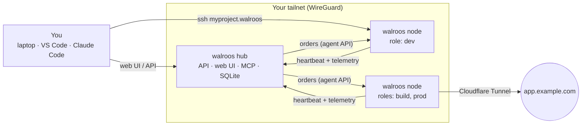

<div align="center">


# walroos

**Self-hosted dev workspaces and deploys on rootless Podman, over your Tailscale network.**

A lightweight devops platform for indie developers: run your dev environments and your apps on your own homelab or VPS, reach them from anywhere, and never open a port.

[](LICENSE)
[](go.mod)


</div>

> [!WARNING]
> walroos is in early development. The fleet (hub + nodes) works; workspaces are being built right now. Expect breaking changes and don't run it anywhere important yet.

## What it does

walroos is one Go binary with an embedded web UI. It does two things:

1. **Remote dev workspaces** (like Coder or DevPod). Spin up a container from a Git repo and its `devcontainer.json` on one of your machines. Connect over SSH from your laptop, VS Code or Claude Code: `ssh myproject.walroos`, and `bun`, compilers and `claude` all live in the container, not on your laptop.
2. **Deploys** (like Dokploy or a self-hosted Vercel). Build a repo, run it as a Podman Quadlet, and put it behind a domain with TLS. It deploys on merge to your protected branch, or when your CI says the tests passed.

Everything sits behind an API, a web UI and an MCP server, so an agent can do anything you can.

### Why

- **Rootless Podman.** No Docker daemon, no root. systemd runs your apps.
- **No open ports.** Machines talk over [Tailscale](https://tailscale.com) (or Headscale). Apps reach the internet through Cloudflare Tunnel, so it works behind CGNAT.
- **Your identity is your tailnet login.** No passwords and no login page: the hub asks Tailscale who is calling and checks an allowlist.
- **Standards, not new formats.** Workspaces use `devcontainer.json`, the same format as Codespaces, DevPod and Coder. Apps use a `Dockerfile`.
- **Small.** One binary and SQLite, with no broker, no Kubernetes and no agent sidecars.

## How it works



- **Hub** (`walroos hub`): the control plane. It joins the tailnet by itself through an embedded Tailscale node (`tsnet`) and serves the API, the UI and, later, MCP.
- **Nodes** (`walroos node`): an agent on each machine. It joins with a one-time token, sends a heartbeat with telemetry every 15s, and runs Podman through its CLI.
  - Each node has roles: `dev` runs workspaces, `build` builds images, `prod` runs apps.
  - The agent API only accepts calls from the hub: the caller's tailnet identity must be the hub's, and it must carry the node's token hash.
- **Workspaces** are a container plus two volumes, one for the repo and one for `$HOME`, so `~/.claude`, shell history and caches survive a rebuild.
  - The container runs as the devcontainer's `remoteUser`, mapped to your host user, so files are yours on both sides.

The full design is in [ARCHITECTURE.md](ARCHITECTURE.md) (in Spanish).

## Requirements

- **Go ≥ 1.27.4** and **[bun](https://bun.sh)** to build.
- **Tailscale** (or Headscale) on every machine; the hub brings its own.
- **Podman** (rootless) and **git** on Linux nodes.

## Quick start

There are no release binaries yet, so build from source:

```bash
git clone https://github.com/jefjesuswt/walroos && cd walroos
cd web && bun install && bun run build && cd ..   # web UI, embedded into the binary
go build -o bin/walroos ./cmd/walroos
```

**1. Start the hub.** The first run needs your tailnet login as owner. To join the tailnet, either open the login URL it prints or pass an auth key:

```bash
./bin/walroos hub --owner you@github
# or: TS_AUTHKEY=tskey-auth-... ./bin/walroos hub --owner you@github
```

**2. Add a node.** Open `http://walroos-hub` from any device on your tailnet, then go to **Nodes → Add node** and copy the join command. On the node:

```bash
walroos node join --hub walroos-hub --token wlr_join_... --roles dev,build
walroos node install   # systemd --user service; or run it in the foreground: walroos node run
```

The node joins the tailnet by itself as `walroos-<name>` (embedded Tailscale, like the hub): the first `join` prints a login URL, or set `TS_AUTHKEY`. It doesn't need Tailscale installed on the machine. It shows up in the UI with live CPU, memory, disk and Podman telemetry.

`node install` starts the agent now and on boot, and restarts it if it crashes (logs: `journalctl --user -u walroos-node -f`). Starting on boot without logging in needs lingering; if it can't enable it, it prints the `sudo loginctl enable-linger` command to run.

<details>
<summary><b>Running next to another VPN (NordVPN, etc.)</b></summary>

Tailscale sends its own traffic around other VPNs, and some VPN firewalls (NordVPN's, for one) drop that traffic, so the login hangs. The hub and the node already handle this: both embed Tailscale in userspace mode. Only a machine where you use the host's `tailscaled` as a client (say, your laptop running `ssh` and `walroos ssh-config`) needs userspace mode, in `/etc/default/tailscaled`:

```bash
FLAGS="--tun=userspace-networking --socks5-server=localhost:1055 --outbound-http-proxy-listen=localhost:1055"
```

Clients on that machine then reach the tailnet through the proxy, for example `walroos ssh-config --proxy localhost:1055`.

</details>

**3. Use it from Claude Code (MCP).** The hub serves MCP at `/mcp`, behind the same Tailscale login as the UI (no token):

```bash
claude mcp add --transport http walroos http://walroos-hub/mcp
```

Tools: `list_nodes`, `list_workspaces`, `detect_stack`, `create_workspace`, `get_workspace`, `start_workspace`, `stop_workspace`, `workspace_ssh_info`. Ask "create a workspace for github.com/you/app" and Claude detects the stack, creates it, waits until it's running and gives you the `ssh` line.

## Development

```bash
go run ./cmd/walroos hub --dev    # 127.0.0.1:8080, no Tailscale, no auth (user dev@localhost)
cd web && bun run dev             # Vite on :5173, proxies /api to the hub
go test ./...
WALROOS_PODMAN_TEST=1 go test ./internal/agent -v   # + workspace lifecycle on real rootless podman
```

```
cmd/walroos/      CLI: hub (control plane), node (agent: join, run, telemetry)
config/           SQLite (WAL) + embedded migrations
internal/agent/   node agent API, workspaces on podman, devcontainer.json
internal/auth/    Tailscale WhoIs + users allowlist
internal/fleet/   nodes: join, heartbeat, telemetry
internal/web/     serves the embedded UI
web/              React + Vite + TypeScript UI
```

Conventions (minimal code, one pattern per domain, migrations, commits) are in [CLAUDE.md](CLAUDE.md). The current task list is in [PLAN.md](PLAN.md). `index.html` at the root is the design prototype the UI is ported from.

## Roadmap

| Milestone | What | Done when | Status |
|---|---|---|---|
| **M0 Base** | Nodes join with a one-time token, heartbeat with telemetry, Tailscale auth, web UI with live nodes | The UI lists nodes with live telemetry | ✅ Done |
| **M1 Workspaces** | Create from a repo + `devcontainer.json`, persistent volumes, SSH gateway, `walroos ssh-config`, UI | `ssh myproject.walroos` from the laptop and `claude` runs inside | ✅ Done |
| **M2 MCP** | `/mcp` on the hub with node and workspace tools | Claude Code creates a workspace and connects to it | In progress |
| **M3 Deploy** | Apps, build + registry, Quadlets, Cloudflare Tunnel ingress, zero-downtime, logs, rollback | A "Deploy" button and `app.example.com` answers with TLS from behind CGNAT | Planned |
| **M4 CI/CD** | Git providers, webhooks via Tailscale Funnel, deploy on push or on CI, deploy tokens | Merge a PR on GitHub and the app updates by itself | Planned |
| **M5** | Preview deploys per PR, compose, devcontainer features, Caddy for nodes with a public IP, notifications | | Later |

M1 progress:
- [x] Hub → agent API, authenticated by tailnet identity and node token
- [x] Database schema for workspaces and SSH keys
- [x] Agent creates, starts, stops and deletes workspaces (clone, `devcontainer.json`, build or pull)
- [x] walroos base image for repos without a devcontainer (Debian, git, mise, sftp-server; user `dev`)
- [x] SSH gateway on the agent (`pty`, `exec`, port forwarding, `sftp`, agent forwarding for `git push`)
- [x] Workspace service on the hub (pick a node, call its agent, keep the state)
- [x] `walroos ssh-config` (add `--proxy` on machines with userspace tailscaled)
- [x] Workspaces page and SSH keys in the UI
- [x] Rebuild a workspace without losing `$HOME`
- [x] Per-workspace environment variables and secrets (encrypted at rest)
- [x] Reach services running on the node (e.g. a database) from a workspace (shared `walroos-dev` network)

### Not planned

- **Multitenancy.** walroos is single-owner. A hosted version would run one walroos instance per tenant on top, not add tenants to the core.
- **Running your CI.** Your forge runs the tests; walroos deploys when they pass.

## Contributing

Issues and pull requests are welcome. walroos is early, so for anything bigger than a fix, open an issue first so we can agree on the approach. Commits follow the conventional style (`feat:`, `fix:`, `docs:` …), and code, comments and UI copy are in English.

## License

[MIT](LICENSE) © 2026 Jeffrey Jesus
